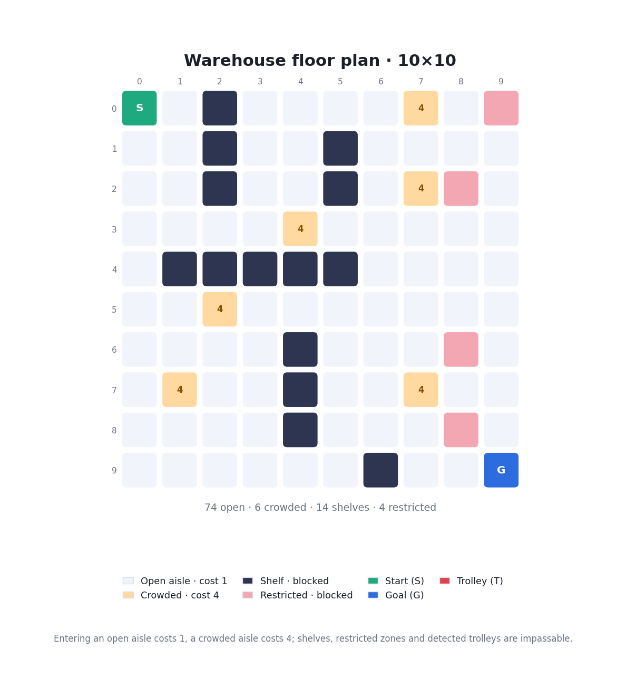
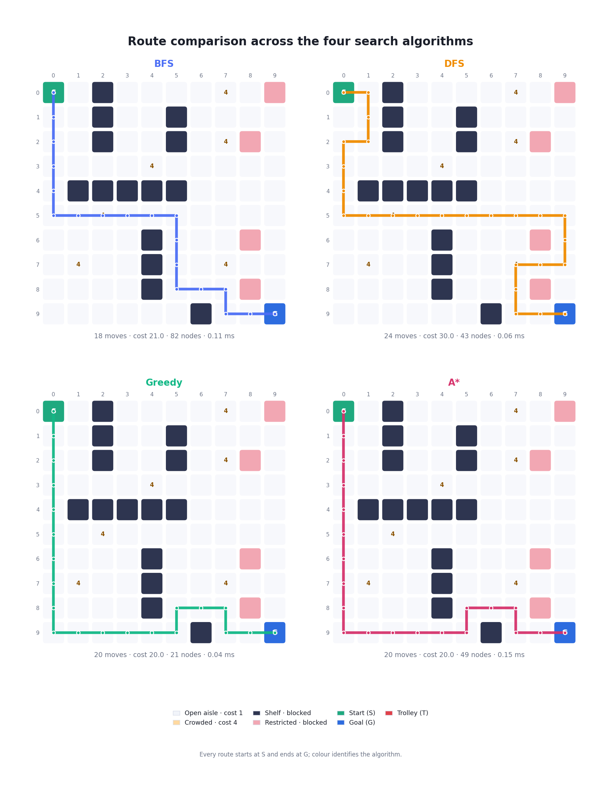
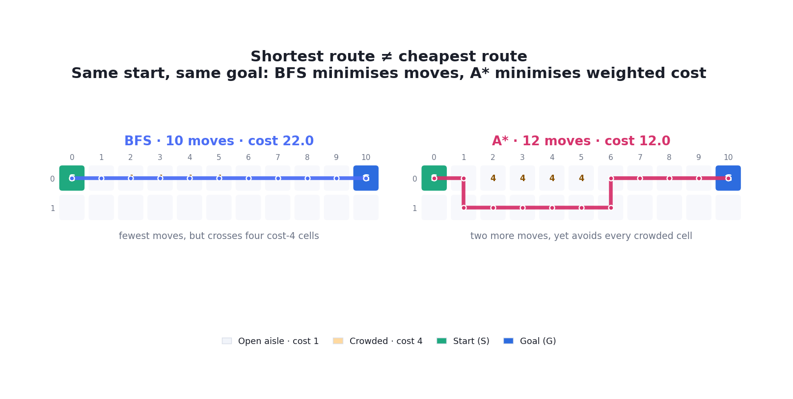
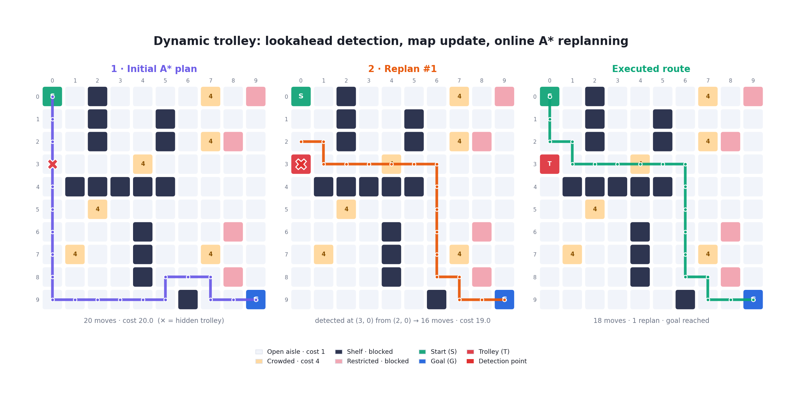
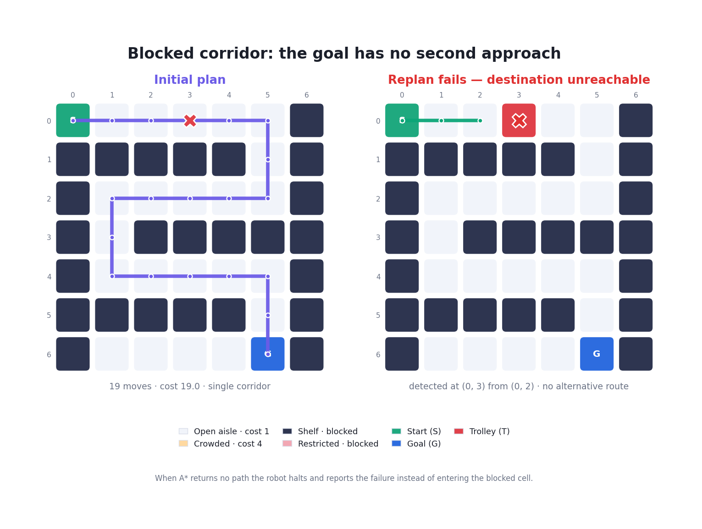
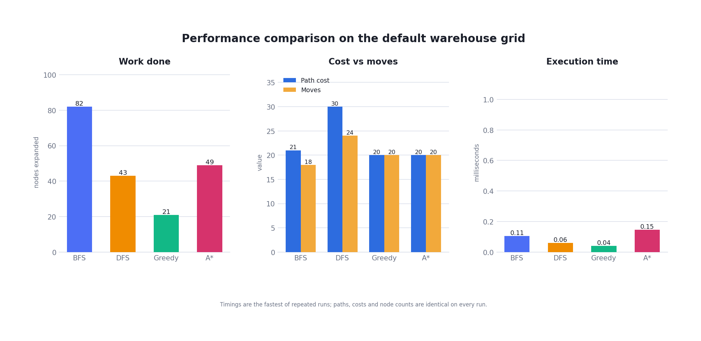
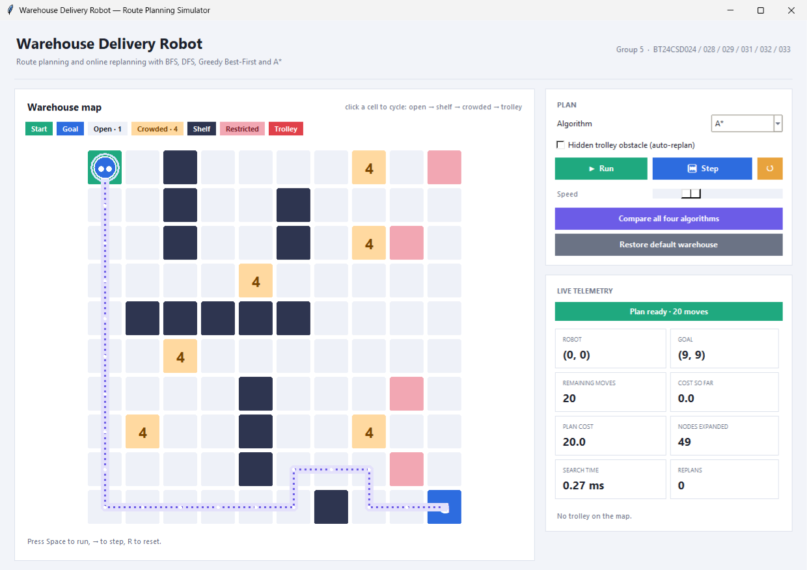

# AI-Based Route Planning for a Warehouse Delivery Robot

**Course:** Artificial Intelligence · **Group:** 5 · **Language:** Python 3 · **Deadline:** 18 November 2026

A simulated warehouse delivery robot that plans a route from the packing station to the
dispatch dock on a 2D floor grid, compares four classical search algorithms, and reacts to
an unexpected trolley blocking its planned route by updating its map and replanning online.



---

## Contents

1. [Problem statement](#1-problem-statement)
2. [Group members & task assignment](#2-group-members--task-assignment)
3. [Quick start](#3-quick-start)
4. [The warehouse model](#4-the-warehouse-model)
5. [Task 1 & 2 — Environment and problem formulation](#5-task-1--2--environment-and-problem-formulation)
6. [Task 3 — Search algorithms](#6-task-3--search-algorithms)
7. [Task 4 — Trolley detection and replanning](#7-task-4--trolley-detection-and-replanning)
8. [Task 5 — Performance evaluation](#8-task-5--performance-evaluation)
9. [Interactive simulator](#9-interactive-simulator)
10. [Project structure](#10-project-structure)
11. [Testing](#11-testing)
12. [Deliverables checklist](#12-deliverables-checklist)
13. [References](#13-references)

---

## 1. Problem statement

A warehouse robot carries packages from a packing station (`S`) to a dispatch area (`G`).
Shelves (`#`) and restricted security zones (`R`) block routes completely; crowded aisles
(`C`) can be crossed but take four times as long as an open aisle (`.`). An unattended
trolley (`T`) may also block a route the robot originally believed to be clear.

The project must:

1. Model the warehouse on a grid with 4-directional movement and a weighted cost model.
2. Formulate the navigation task as a formal search problem.
3. Implement **BFS, DFS, Greedy Best-First Search** and **A\***, using Manhattan distance as
   the heuristic, and show that the shortest route is not always the cheapest.
4. Detect a trolley that is missing from the robot's map, update the map and replan with A\*
   from the robot's current position — reporting failure when no alternative exists.
5. Compare the algorithms on goal reached, moves, path cost, nodes expanded and execution
   time, and record the number of replans for the trolley experiment.

---

## 2. Group members & task assignment

| Member | Name | Roll number | Responsibility | Primary contribution |
|---|---|---|---|---|
| 1 | **Dev Goyal** | `BT24CSD029` | Warehouse grid & problem formulation | `WarehouseGrid`: cell vocabulary, cost model, movement rules, validation, console and visual presentation (`warehouse_grid.py`) |
| 2 | **Yash Joshi** | `BT24CSD024` | BFS and DFS | FIFO-queue BFS and LIFO-stack DFS with visited-state tracking (`search_algorithms.py`) |
| 3 | **Yuvraj Singh** | `BT24CSD031` | Greedy Best-First Search & heuristic | Priority-queue Greedy search plus the Manhattan admissibility and consistency proof (`search_algorithms.py`) |
| 4 | **Harsh Patil** | `BT24CSD033` | A\* and weighted costs | $f(n)=g(n)+h(n)$ A\* with a `start_override` for replanning, weighted-cost trade-off analysis (`search_algorithms.py`) |
| 5 | **Piyush Mangalam** | `BT24CSD032` | Trolley detection, map update, replanning | Three-grid `TrolleySimulator`: one-step lookahead, dynamic map update, online A\*, blocked-corridor failure case (`trolley_replanning.py`) |
| 6 | **Sayan Majhi** | `BT24CSD028` | Testing, visualisation, evaluation, docs | 51-test suite, benchmark harness and tables, Matplotlib figure engine, Tkinter simulator, documentation (`tests.py`, `metrics.py`, `visualization.py`, `gui.py`) |

Each member can explain, run and modify their own module; the integration report in `main.py`
is shared.

---

## 3. Quick start

```bash
pip install -r requirements.txt      # numpy, matplotlib

python main.py                       # full report, all figures, measured results
python gui.py                        # interactive simulator (or: python main.py --gui)
python -m unittest tests.py -v       # 51 tests
```

`python main.py` prints every task's output, writes six figures to `screenshots/`, and writes
`results/performance_results.md` with the numbers measured on that run.

Requirements: Python 3.9+ (checked on 3.10), `numpy>=1.24`, `matplotlib>=3.7`, and `tkinter`
(standard library) for the GUI. `main.py` reconfigures stdout to UTF-8 so the box-drawn report
also works on a Windows console or when piped to a file.

---

## 4. The warehouse model

Seven cell types, each a single character:

| Symbol | Cell | Passable | Entry cost |
|:---:|---|:---:|:---:|
| `.` | Open aisle | yes | 1 |
| `C` | Crowded aisle (staff, carts) | yes | 4 |
| `#` | Shelf | no | ∞ |
| `R` | Restricted security zone | no | ∞ |
| `S` | Start — packing station | yes | 1 |
| `G` | Goal — dispatch dock | yes | 1 |
| `T` | Trolley (once detected) | no | ∞ |

Default 10×10 floor plan (74 open aisles, 6 crowded cells, 14 shelves, 4 restricted zones):

```text
    0 1 2 3 4 5 6 7 8 9
 0  S . # . . . . C . R
 1  . . # . . # . . . .
 2  . . # . . # . C R .
 3  . . . . C . . . . .
 4  . # # # # # . . . .
 5  . . C . . . . . . .
 6  . . . . # . . . R .
 7  . C . . # . . C . .
 8  . . . . # . . . R .
 9  . . . . . . # . . G
```

* A shelf wall in column 2 (rows 0–2) and a five-cell wall in row 4 (columns 1–5) split the
  floor into a northern and a southern half.
* A shelf column at (6–9, 4) funnels the southern half into two exits.
* Six crowded cells make the direct routes expensive, which is what separates minimum moves
  from minimum cost.
* Four restricted zones `R` seal the eastern aisle at (0,9), (2,8), (6,8) and (8,8).

---

## 5. Task 1 & 2 — Environment and problem formulation

**State space** — $S = \{(r,c) \mid 0 \le r < 10,\ 0 \le c < 10\}$: the robot's row and
column. Impassable cells are excluded from the reachable state space.

**Initial state** — $s_0 = (0,0)$, the packing station `S`.

**Actions** — $A(s) \subseteq \{\text{UP},\text{DOWN},\text{LEFT},\text{RIGHT}\}$ with
vectors $(-1,0), (1,0), (0,-1), (0,1)$, filtered to in-bounds, passable cells.

**Transition model** — deterministic: $\text{Result}(s,a) = (r + \Delta r,\ c + \Delta c)$.

**Goal test** — $\text{IsGoal}(s) \iff s = (9,9)$.

**Path cost** — the sum of the entry costs of every cell entered, excluding the start:

$$g(p) = \sum_{i=1}^{n} c(p_{i-1}, a_i, p_i), \qquad c(\cdot) = \begin{cases}1 & \text{open}\\ 4 & \text{crowded}\end{cases}$$

```python
grid.actions((1, 1))      # [ (0,1,'UP'), (2,1,'DOWN'), (1,0,'LEFT'), (1,2,'RIGHT') ]
grid.result((1, 1), (0, 2, 'RIGHT'))   # (1, 2)
grid.path_cost([(0,0), (0,1), (0,2)])  # 2.0  — start cell is free
```

`WarehouseGrid` validates its input: a layout with ragged rows, or without `S`/`G`, raises
`ValueError` instead of producing a broken map. The same class also provides `mark_impassable`
and `clone`, which Task 4 relies on.

Full detail: [`task_reports/Task1_Warehouse_Environment.md`](task_reports/Task1_Warehouse_Environment.md)
and [`task_reports/Task2_Problem_Formulation.md`](task_reports/Task2_Problem_Formulation.md).

---

## 6. Task 3 — Search algorithms

| Algorithm | Frontier | Priority | Complete | Optimal |
|---|---|---|:---:|---|
| **BFS** | FIFO queue | depth | yes | fewest **moves** |
| **DFS** | LIFO stack | depth (newest first) | yes (visited set) | no |
| **Greedy** | min-heap | $h(n)$ | yes | no |
| **A\*** | min-heap | $f(n) = g(n) + h(n)$ | yes | lowest **cost** |

**Heuristic.** $h(n) = |r - r_G| + |c - c_G|$. A 4-connected grid needs at least $h(n)$ moves
to reach the goal, and every move enters a cell of cost ≥ 1, so the true remaining cost
satisfies $h^*(n) \ge h(n)$: the heuristic never over-estimates. It is also consistent, since
one step changes $h$ by at most 1 while costing at least 1 — so A\* with graph search never
needs to re-expand a node and returns a lowest-cost path.

### 6.1 Routes on the default grid



BFS descends column 0, crosses row 5 through the crowded cell at (5,2), and continues east.
A\* and Greedy go all the way down column 0 and along row 9, which costs two more moves but
avoids every crowded cell. DFS dives to the east wall first and comes back, producing the
longest and most expensive route.

### 6.2 Shortest route ≠ cheapest route

A dedicated two-row corridor isolates the effect: the direct top route is 10 moves but
crosses four crowded cells, while the lower detour is 12 moves of open aisle.



| Algorithm | Moves | Path cost | Why |
|---|:---:|---:|---|
| BFS | **10** | 22.0 | straight through `CCCC` — fewest moves, four ×4 cells |
| A\* | 12 | **12.0** | detours through the open row — two extra moves, saves 10.0 |

Full detail: [`task_reports/Task3_Search_Algorithms.md`](task_reports/Task3_Search_Algorithms.md).

---

## 7. Task 4 — Trolley detection and replanning

The simulator keeps three maps: `base_grid` (reference copy), `known_grid` (the robot's
beliefs, updated when an obstacle is seen) and `real_grid` (ground truth, where the trolley
actually is). The robot moves one cell at a time and checks the next cell with a one-step
lookahead before entering it. A detection triggers: halt → mark the cell impassable in the
robot's map → replan with A\* from the current position → follow the new plan.



Measured on this run:

| Step | Value |
|---|---|
| Hidden trolley | (3, 0), the fourth cell of the plan — unknown to the robot |
| Initial A\* plan | 20 moves, cost 20.0 |
| Detection | at (3, 0) while the robot stands at (2, 0) |
| Replan | 16 moves, cost 19.0, 34 nodes expanded |
| Executed route | 18 moves, 1 replan, **goal reached** |

### 7.1 When no alternative exists

Task 4 also requires reporting the failure case. A one-cell-wide serpentine corridor gives the
goal a single approach; once the trolley blocks it, replanning honestly returns no path:



| Step | Value |
|---|---|
| Hidden trolley | (0, 3) |
| Initial plan | 19 moves, cost 19.0 |
| Replan | no path — `astar()` returns `None` |
| Outcome | robot halts before the obstacle and reports the destination unreachable |

Full detail: [`task_reports/Task4_Trolley_Replanning.md`](task_reports/Task4_Trolley_Replanning.md).

---

## 8. Task 5 — Performance evaluation

All four algorithms run on the same default grid. Paths, costs and node counts are
deterministic; timings are the fastest of 25 runs per algorithm (rounded to 0.01 ms), because a
single search finishes in well under a millisecond and one measurement is dominated by
scheduling noise.

| Algorithm | Goal reached | Moves | Path cost | Nodes expanded | Time (ms) |
|---|:---:|:---:|---:|---:|---:|
| **BFS** | yes | **18** | 21.0 | 82 | 0.11 |
| **DFS** | yes | 24 | 30.0 | 43 | 0.06 |
| **Greedy** | yes | 20 | 20.0 | **21** | **0.04** |
| **A\*** | yes | 20 | **20.0** | 49 | 0.15 |



**Does the shortest route also have the lowest cost? No.** BFS finds the fewest moves (18) but
pays 21.0 because its route crosses the crowded cell at (5,2); A\* takes 20 moves and pays
20.0 by staying in open aisles. The two-row corridor makes the point even sharper: 10 moves at
cost 22.0 versus 12 moves at cost 12.0.

Other findings:

* **A\*** is the only algorithm that guarantees the lowest cost, and it expands 49 nodes —
  40 % fewer than BFS, which must exhaust every depth level.
* **Greedy** expands the fewest nodes (21) and is fastest here, but its success is not
  guaranteed: it found the same 20.0-cost route as A\* purely because the heuristic happened
  to point the right way on this map.
* **DFS** is the cautionary tale: 24 moves, cost 30.0, and the lowest cost-efficiency despite
  modest expansion.
* **Replanning** costs the robot one extra cost unit: the replanned tail is 16 moves at 19.0
  versus the 18-move, 18.0 tail that the trolley blocked — and the delivery still succeeds.

The measured numbers on the machine that ran the demo are written to
[`results/performance_results.md`](results/performance_results.md) on every `python main.py`.

---

## 9. Interactive simulator

`python gui.py` opens a Tkinter simulator: pick an algorithm, play or step the route, edit
cells by clicking them (`open → shelf → crowded → trolley`), arm the hidden-trolley mode to
watch detection and live replanning, and open a comparison table for the current map.
Keyboard: `Space` run/pause, `→` step, `R` reset.



---

## 10. Project structure

```text
AI_Warehouse_PathPlanning_Group5/
├── warehouse_grid.py        # Cell vocabulary, cost model, movement, validation (Tasks 1 & 2)
├── search_algorithms.py     # BFS, DFS, Greedy, A* + Manhattan heuristic (Task 3)
├── trolley_replanning.py    # TrolleySimulator: lookahead, map update, replanning (Task 4)
├── metrics.py               # Benchmark harness, console tables, results file (Task 5)
├── visualization.py         # Matplotlib figure engine (Task 5)
├── gui.py                   # Interactive Tkinter simulator
├── main.py                  # End-to-end report: python main.py [--gui]
├── tests.py                 # 51 unit and integration tests
├── requirements.txt
├── README.md
├── AI_Warehouse_Robot_Group_Assignment.md   # Assignment brief
├── task_reports/            # One detailed report per task
│   ├── README.md
│   ├── Task1_Warehouse_Environment.md
│   ├── Task2_Problem_Formulation.md
│   ├── Task3_Search_Algorithms.md
│   ├── Task4_Trolley_Replanning.md
│   └── Task5_Performance_Evaluation.md
├── results/
│   └── performance_results.md   # Written by main.py — always matches the last run
└── screenshots/
    ├── grid_overview.png
    ├── algorithm_routes.png
    ├── cost_vs_moves.png
    ├── trolley_replanning.png
    ├── no_alternative_path.png
    ├── performance_chart.png
    └── gui.png
```

---

## 11. Testing

```bash
python -m unittest tests.py -v     # 51 tests, all passing
python -m pytest tests.py -v       # same suite, if pytest is installed
```

Coverage: grid construction and validation, cell costs, restricted zones, actions and bounds,
path cost, cloning; Manhattan correctness; goal/no-goal behaviour and path connectivity for
each algorithm; A\* optimality against BFS and Greedy, detour selection and `start_override`;
the trolley simulation, including the blocked-corridor failure where the robot never enters
the blocked cell; and the benchmark harness, which must reproduce the deterministic metrics.

---

## 12. Deliverables checklist

| Requirement | Where |
|---|---|
| Complete Python source | `warehouse_grid.py`, `search_algorithms.py`, `trolley_replanning.py`, `metrics.py`, `visualization.py`, `gui.py`, `main.py` |
| Problem statement, algorithms, dependencies, run instructions | this README |
| Screenshots of program output, including the trolley demonstration | `screenshots/` (7 figures) |
| Performance comparison table | §8 and `results/performance_results.md` |
| Shortest-route-vs-lowest-cost explanation | §6.2, §8 |
| Names, roll numbers and contributions | §2 |
| Task matrix | §2, `task_reports/` |
| Every task documented in detail | `task_reports/Task1` … `Task5` |

---

## 13. References

1. Russell, S., & Norvig, P. (2020). *Artificial Intelligence: A Modern Approach* (4th ed.).
   Pearson — chapters 3 and 4 (uninformed and informed search).
2. Hart, P. E., Nilsson, N. J., & Raphael, B. (1968). *A Formal Basis for the Heuristic
   Determination of Minimum Cost Paths*. IEEE Transactions on Systems Science and Cybernetics.
3. Python standard library: `collections.deque`, `heapq`, `unittest`, `tkinter`, `time`.
4. Matplotlib and NumPy documentation and open-source communities.
