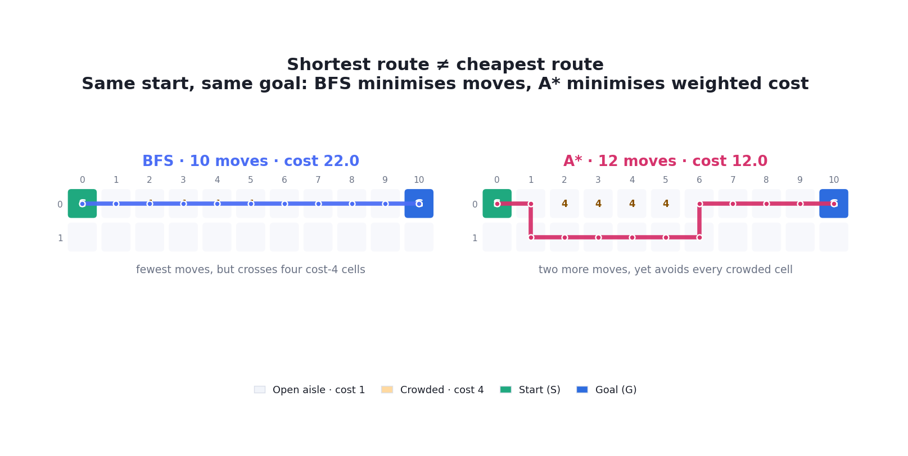

# Task 3 — Search Algorithms

**Assigned To:**
- Yash Joshi (BT24CSD024) — BFS and DFS
- Yuvraj Singh (BT24CSD031) — Greedy Best-First Search and the heuristic proof
- Harsh Patil (BT24CSD033) — A\* and weighted path costs

**Source File:** [`search_algorithms.py`](../search_algorithms.py)
**Objective:** Implement BFS, DFS, Greedy Best-First Search and A\* on the same warehouse
grid, use Manhattan distance for the informed searches, prove it is a lower bound, and
demonstrate that the shortest route is not always the cheapest.

---

## 3.1 Shared infrastructure

All four algorithms share a frontier, a `came_from` map and a `SearchResult`:

```python
class SearchResult:
    algorithm: str                 # 'BFS' | 'DFS' | 'Greedy' | 'A*'
    path: Optional[List[Tuple[int, int]]]   # None when the goal is unreachable
    nodes_expanded: int            # states removed from the frontier
    path_cost: float               # sum of entry costs, start excluded
    path_length: int               # moves = len(path) - 1
    elapsed_sec: float             # wall-clock time of the search
    goal_reached: bool
```

```python
def _reconstruct(came_from, goal):
    path, node = [], goal
    while node is not None:
        path.append(node)
        node = came_from[node]
    return path[::-1]
```

The module also exposes `ALGORITHMS = {'BFS': bfs, 'DFS': dfs, 'Greedy': greedy, 'A*': astar}`,
which the GUI, the benchmark and the comparison table all iterate over, and `run_all(grid)`.

---

## 3.2 Breadth-First Search — Yash Joshi (BT24CSD024)

**Concept.** Explore level by level with a FIFO queue. The first time the goal is dequeued, it
is at minimum depth, so the path has the fewest moves.

| Property | Value |
|---|---|
| Frontier | `collections.deque`, `popleft()` |
| Complete | yes (finite state space) |
| Optimal | fewest **moves**, not lowest cost |
| Time / space | $O(b^d)$ |

```python
state = frontier.popleft()          # FIFO
if grid.goal_test(state):
    return SearchResult('BFS', _reconstruct(came_from, state), ...)
for nr, nc, _ in grid.actions(state):
    if (nr, nc) not in came_from:
        came_from[(nr, nc)] = state
        frontier.append((nr, nc))
```

**Route on the default grid** (`*` marks the path):

```text
   0 1 2 3 4 5 6 7 8 9
 0 S . # . . . . C . R
 1 * . # . . # . . . .
 2 * . # . . # . C R .
 3 * . . . C . . . . .
 4 * # # # # # . . . .
 5 * * * * * * . . . .
 6 . . . . # * . . R .
 7 . C . . # * . C . .
 8 . . . . # * * * R .
 9 . . . . . . # * * G
```

| Moves | Cost | Nodes | Time |
|---:|---:|---:|---:|
| **18** | 21.0 | 82 | 0.11 ms |

The 18-move route crosses the crowded cell (5,2), which costs 4 instead of 1 — fewest moves,
but not the cheapest path. BFS also expands the most nodes: it must drain every state at
depths 0–17 before it reaches the goal.

---

## 3.3 Depth-First Search — Yash Joshi (BT24CSD024)

**Concept.** Explore the newest state first with a LIFO stack, tracking visited states so the
search terminates on a cyclic graph.

| Property | Value |
|---|---|
| Frontier | Python `list`, `pop()` |
| Complete | yes, with a visited set on a finite graph |
| Optimal | no |
| Time / space | $O(b^m)$ time, $O(bm)$ stack |

```python
state = frontier.pop()             # LIFO — dives deep
```

**Route:**

```text
   0 1 2 3 4 5 6 7 8 9
 0 S * # . . . . C . R
 1 . * # . . # . . . .
 2 * * # . . # . C R .
 3 * . . . C . . . . .
 4 * # # # # # . . . .
 5 * * * * * * * * * *
 6 . . . . # . . . R *
 7 . C . . # . . * * *
 8 . . . . # . . * R .
 9 . . . . . . # * * G
```

| Moves | Cost | Nodes | Time |
|---:|---:|---:|---:|
| 24 | 30.0 | 43 | 0.06 ms |

DFS is fast and finds *a* path, but a poor one: it dives east along row 5, hits the east wall,
and comes back through two crowded cells. This is the classic DFS failure mode — no cost
awareness and no preference for shallow solutions.

---

## 3.4 Greedy Best-First Search — Yuvraj Singh (BT24CSD031)

**Concept.** Always expand the state that *looks* closest to the goal: a min-heap ordered by
$h(n)$ only, with a counter to break ties deterministically.

| Property | Value |
|---|---|
| Frontier | `heapq`, key $(h(n), \text{counter}, n)$ |
| Complete | yes (finite graph, visited set) |
| Optimal | no — ignores $g(n)$ |
| Worst case | $O(b^m)$ |

```python
heapq.heappush(frontier, (manhattan(grid.start, grid.goal), counter, grid.start))
_, _, state = heapq.heappop(frontier)
```

**Route:** identical to A\* on this map (see 3.5).

| Moves | Cost | Nodes | Time |
|---:|---:|---:|---:|
| 20 | 20.0 | **21** | **0.04 ms** |

Greedy expands less than half the nodes BFS does and reaches the same 20.0 cost — but that is
luck, not a guarantee. Greedy has no mechanism to reject an expensive cell if it happens to
lie in the direction of the goal.

---

## 3.5 A\* — Harsh Patil (BT24CSD033)

**Concept.** Order the frontier by $f(n) = g(n) + h(n)$: the real cost so far plus the
estimated remaining cost.

| Property | Value |
|---|---|
| Frontier | `heapq`, key $(f(n), \text{counter}, n)$ |
| Complete | yes |
| Optimal | yes, with an admissible heuristic |
| Extra API | `start_override` — replan from any cell (used by Task 4) |

```python
frontier = [(manhattan(src, grid.goal), 0, src)]
g_cost = {src: 0.0}
while frontier:
    f, _, state = heapq.heappop(frontier)
    if g_cost.get(state, inf) < f - manhattan(state, grid.goal):
        continue                       # stale heap entry
    if grid.goal_test(state):
        return SearchResult('A*', _reconstruct(came_from, state), ...)
    for nr, nc, _ in grid.actions(state):
        new_g = g_cost[state] + grid.entry_cost(nr, nc)
        if new_g < g_cost.get((nr, nc), inf):
            g_cost[(nr, nc)] = new_g
            came_from[(nr, nc)] = state
            heapq.heappush(frontier, (new_g + manhattan((nr, nc), grid.goal), c, (nr, nc)))
```

**Route** (shared with Greedy):

```text
   0 1 2 3 4 5 6 7 8 9
 0 S . # . . . . C . R
 1 * . # . . # . . . .
 2 * . # . . # . C R .
 3 * . . . C . . . . .
 4 * # # # # # . . . .
 5 * . C . . . . . . .
 6 * . . . # . . . R .
 7 * C . . # . . C . .
 8 * . . . # * * * R .
 9 * * * * * * # * * G
```

| Moves | Cost | Nodes | Time |
|---:|---:|---:|---:|
| 20 | **20.0** | 49 | 0.15 ms |

A\* deliberately spends two extra moves to stay in cost-1 aisles: it is the cheapest route on
the map, and it expands 40 % fewer nodes than BFS while doing it.

---

## 3.6 Why Manhattan distance is admissible

$$h(n) = |r - r_G| + |c - c_G|$$

**Claim.** $h(n) \le h^*(n)$ for every state, where $h^*$ is the true optimal remaining cost.

1. In a 4-connected grid each move changes the row or the column by exactly 1, so reaching
   $(r_G,c_G)$ needs at least $|r-r_G| + |c-c_G|$ moves.
2. Every move enters a cell whose entry cost is at least $c_{\min} = 1$.
3. Hence $h^*(n) \ge c_{\min} \cdot h(n) = h(n)$. The heuristic never over-estimates, so it is
   **admissible**, and A\* returns a lowest-cost path.
4. It is also **consistent**: one step changes $h$ by at most 1 while costing at least 1, so
   $h(n) \le c(n,a,n') + h(n')$. With a consistent heuristic A\* never re-expands a node, which
   is why the `g_cost` dictionary is enough and no closed set is needed.
5. Manhattan is exact for open grids and only becomes loose where shelves force detours — the
   detours are exactly where $h$ stays below $h^*$, which preserves admissibility.

---

## 3.7 Shortest route ≠ cheapest route



The two-row corridor `S.CCCC....G` over `...........` isolates the effect:

| | BFS | A\* |
|---|---|---|
| Route | straight along row 0 through `CCCC` | down to row 1, across, back up |
| Moves | **10** | 12 |
| Path cost | 22.0 | **12.0** |

Both are "optimal" in their own metric. BFS minimises the number of edges because every edge
looks equal to it; A\* minimises the sum of entry costs and happily pays two extra moves to
avoid four cells that cost 4 instead of 1. Ten extra moves would still be worth it here: the
saving per avoided crowded cell (3) is larger than the cost of a detour step (1).

The same effect appears, more subtly, on the default grid — BFS 18 moves / 21.0 versus A\*
20 moves / 20.0.

---

## 3.8 Summary

| Algorithm | Goal | Moves | Cost | Nodes | Time (ms) |
|---|:---:|---:|---:|---:|---:|
| BFS | yes | **18** | 21.0 | 82 | 0.11 |
| DFS | yes | 24 | 30.0 | 43 | 0.06 |
| Greedy | yes | 20 | 20.0 | **21** | **0.04** |
| A\* | yes | 20 | **20.0** | 49 | 0.15 |

* **Fewest moves:** BFS (guaranteed by FIFO level-order expansion).
* **Lowest cost:** A\* (guaranteed by admissibility); Greedy ties here by coincidence.
* **Least work:** Greedy, 21 nodes — but with no optimality guarantee.
* **Most expensive route:** DFS, 30.0, from its depth-first wander.

Timings are the fastest of 25 runs per algorithm (`metrics.benchmark`), rounded to 0.01 ms;
moves, costs and node counts are identical on every run.

---

## 3.9 Tests

| Class | Tests | Covers |
|---|---|---|
| `TestManhattan` | 3 | zero distance, known distance, symmetry |
| `TestBFS` | 4 | reachability, blocked map, path connectivity, optimal move count |
| `TestDFS` | 3 | reachability, blocked map, connectivity |
| `TestGreedy` | 2 | reachability, blocked map |
| `TestAStar` | 6 | reachability, blocked map, cost ≤ BFS, cost ≤ Greedy, detour selection, `start_override` |
| `TestCostVsMoves` | 2 | BFS 10 moves / 22.0 and A\* 12 moves / 12.0 on the corridor |
| `TestRunAll` | 2 | registry returns four named results, all reach the goal |

---

## 3.10 Visual output

[`screenshots/algorithm_routes.png`](../screenshots/algorithm_routes.png) — 2×2 route
comparison with per-algorithm metrics, and
[`screenshots/cost_vs_moves.png`](../screenshots/cost_vs_moves.png) — the corridor comparison.
