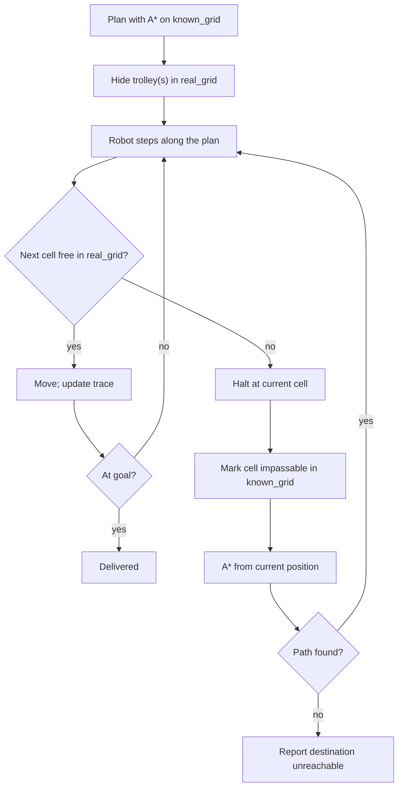

# Task 4 — Trolley Detection and Replanning

**Assigned To:** Piyush Mangalam (BT24CSD032)
**Source File:** [`trolley_replanning.py`](../trolley_replanning.py)
**Objective:** Simulate a trolley that is missing from the robot's map but blocks its planned
route. The robot must detect it before entering the cell, update its map, replan with A\* from
its current position, follow the new route — or report that no alternative exists.

---

## 4.1 Why three maps

The core of the task is a difference in *knowledge*, not in geometry. The simulator therefore
keeps three grids:

| Grid | Meaning | Trolleys |
|---|---|---|
| `base_grid` | Reference copy of the floor plan | none |
| `known_grid` | What the robot believes; updated when it sees an obstacle | added on detection |
| `real_grid` | Ground truth used by the "sensor" | placed at construction |

Planning uses `known_grid`, detection compares the next cell against `real_grid`. Nothing else
in the code has to model partial observability — the three maps *are* the model.

```python
self.base_grid  = base_grid.clone()
self.known_grid = base_grid.clone()
self.real_grid  = base_grid.clone()
init = astar(self.known_grid)              # plan on clean knowledge
for r, c in self.trolley_positions:
    self.real_grid.mark_impassable(r, c)   # hide the obstacle in the world
```

---

## 4.2 API

```python
class ReplanEvent:
    replan_no: int                     # 1, 2, …
    detected_at: Tuple[int, int]       # cell found blocked
    current_pos: Tuple[int, int]       # where the robot stood when it saw it
    new_path: Optional[List[...]]      # None when unreachable
    search_result: SearchResult        # cost, nodes, timing of the replan

class SimulationResult:
    initial_path, initial_result, final_trace, replan_events,
    replan_count, goal_reached, trolley_positions
```

`TrolleySimulator(base_grid, trolley_positions=None)` auto-places one trolley on the fourth
cell of the initial A\* plan when no positions are given, so the demo always exercises a
replan. Custom positions, including several, are supported.

---

## 4.3 Workflow



Two details make this *online* replanning rather than re-planning from scratch:

* the search starts at the robot's current cell (`start_override`), never at `S`;
* the robot keeps the cells it already traversed — `final_trace` records the whole executed
  route, not just the last plan.

---

## 4.4 Measured run on the default grid

The trolley is placed at (3,0), the fourth cell of the initial plan, and is invisible to the
robot.

```text
Initial A* plan : (0,0) → (1,0) → … → (9,0) → (9,1) … (9,5) → (8,5) → (8,6) → (8,7)
                  → (9,7) → (9,8) → (9,9)
Initial cost    : 20.0 (20 moves)
```

| Event | Detail |
|---|---|
| Detection | (3,0), while the robot stands at (2,0) — before entering |
| Map update | (3,0) marked impassable in `known_grid` |
| Replan | 16 moves, cost 19.0, 34 nodes expanded |
| Executed route | 18 moves, 1 replan |
| Outcome | **goal reached** |

The replanned route pivots right at row 2, runs along row 3, drops down column 6 and rejoins
the original approach:

```text
   0 1 2 3 4 5 6 7 8 9
 0 S . # . . . . C . R
 1 . . # . . # . . . .
 2 * * # . . # . C R .
 3 T * * * * * * . . .
 4 . # # # # # * . . .
 5 . . C . . . * . . .
 6 . . . . # . * . R .
 7 . C . . # . * C . .
 8 . . . . # . * * R .
 9 . . . . . . # * * G
```

Cost of resilience: the tail the robot ends up walking costs 19.0 against the 18.0 tail of the
blocked plan — one extra cost unit, and the delivery still happens.

```text
═══════════════════════════════════════════════════════
  TROLLEY REPLANNING METRICS
═══════════════════════════════════════════════════════
  Metric                         Value
───────────────────────────────────────────────────────
  Trolley position(s)            [(3, 0)]
  Initial path cost              20.0
  Initial path length            20 moves
  Number of replans              1
  Goal reached                   Yes ✓
    Replan #1 cost               19.0
    Replan #1 moves              16
    Replan #1 nodes              34
═══════════════════════════════════════════════════════
```

---

## 4.5 The failure case: no alternative route

The task requires reporting when no alternative exists, so the project ships a one-cell-wide
serpentine corridor (`BOTTLENECK_LAYOUT`) whose goal has exactly one approach:

```text
   0 1 2 3 4 5 6
 0 S . . . . . #
 1 # # # # # . #
 2 # . . . . . #
 3 # . # # # # #
 4 # . . . . . #
 5 # # # # # . #
 6 # . . . . G #
```

Because the state graph is undirected, every cell on that single corridor is an articulation
point: blocking one disconnects `G` completely.

| Event | Detail |
|---|---|
| Initial plan | 19 moves, cost 19.0 |
| Trolley | (0,3), hidden |
| Detection | at (0,3) from (0,2) |
| Replan | **no path** — `astar()` returns `None` |
| Outcome | robot halts, reports the destination unreachable |

```text
  ── Replan #1 ──
     Trolley detected at : (0, 3)
     Robot was at        : (0, 2)
     *** NO ALTERNATIVE PATH — destination unreachable ***
```

The simulator does not silently give up: `replan_count` still increments, the `ReplanEvent`
records `new_path = None`, and `goal_reached` is `False`. The robot never enters the blocked
cell, which the test suite asserts directly.

---

## 4.6 Design decisions

1. **One-step lookahead, not full visibility.** The robot inspects only the next cell, which is
   the realistic sensor model and makes detection timing meaningful.
2. **Replan from the current cell.** Replanning from `S` would produce a route the robot cannot
   reach without backtracking through cells it has already left.
3. **Detection compares `real_grid` with `known_grid`.** Without the second half of that test a
   permanently blocked cell would trigger a fresh replan on every visit.
4. **Auto-placement on the plan.** Guarantees the demo exercises a replan; positional overrides
   allow experiments with several trolleys.
5. **Undirected graph ⇒ honest failure.** Blocking a bridge really does make the goal
   unreachable, so "no path" is a genuine result rather than a search bug.

---

## 4.7 Tests

| Test | Verifies |
|---|---|
| `test_simulation_runs` | The simulation completes without exceptions |
| `test_replan_count_positive` | A placed trolley causes at least one replan |
| `test_goal_reachable_without_trolley` | With `trolley_positions=[]` the goal is always reached |
| `test_custom_trolley_position` | A trolley on the third cell triggers exactly one replan |
| `test_trace_starts_at_start` | The executed trace begins at `S` |
| `test_replan_reports_unreachable` | Blocked corridor ⇒ 1 replan, `new_path is None`, goal not reached |
| `test_robot_never_enters_the_blocked_cell` | The trolley cell is absent from `final_trace` |

---

## 4.8 Visual output

* [`screenshots/trolley_replanning.png`](../screenshots/trolley_replanning.png) — initial plan,
  detection, replanned route, executed trace.
* [`screenshots/no_alternative_path.png`](../screenshots/no_alternative_path.png) — the blocked
  corridor and the failed replan.
