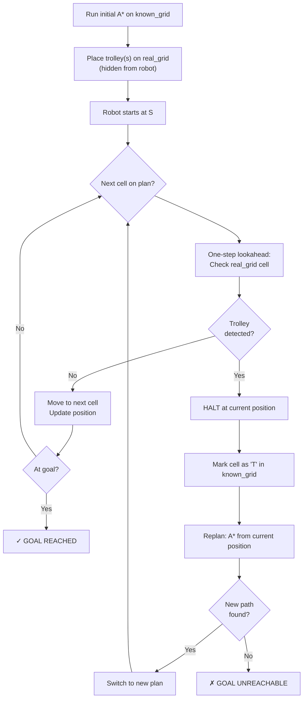

# Task 4 — Obstacle Detection & Replanning

**Assigned To:** Piyush Mangalam (BT24CSD032)  
**Source File:** [`trolley_replanning.py`](../trolley_replanning.py)  
**Objective:** Simulate the robot encountering a dynamic trolley obstacle on its planned A* route. The robot detects the obstacle before entering the blocked cell, updates its internal map, replans with A* from its current position, and reports the revised route — or declares the goal unreachable if no alternative exists.

---

## 4.1 Overview

In a real warehouse, the robot may encounter unexpected obstacles (e.g., parked trolleys, spilled goods, temporary barriers) that were not part of its original map. This task simulates this scenario:

1. The robot plans an initial optimal path using A* on its **known** (clean) map.
2. A trolley (`T`) is secretly placed on a cell along that planned path in the **real world**, but the robot's internal map does not know about it.
3. The robot begins traversing its plan step by step.
4. Before entering each cell, the robot's forward sensor performs a **one-step lookahead** check.
5. If the next cell is blocked by a trolley: the robot **halts**, **updates its internal map** (marks the cell as impassable), and **replans** using A* from its current position.
6. If a viable alternative route exists, the robot follows the new plan. If not, the robot reports that the destination is unreachable.

---

## 4.2 System Architecture

The trolley replanning system consists of two classes:

### `TrolleySimulator` — Simulation Engine

Manages three separate grid instances:

| Grid | Purpose | Trolley knowledge |
|------|---------|-------------------|
| `base_grid` | Original clean grid (reference copy) | No trolleys |
| `known_grid` | Robot's internal map (evolves during simulation) | Trolleys added when detected |
| `real_grid` | The "physical" world (ground truth) | Trolleys placed at initialisation |

This separation models the **partial observability** of the real world: the robot can only see one step ahead and discovers obstacles through its sensors, not through prior knowledge.

### `ReplanEvent` — Event Record

Captures the details of each replanning episode:

```python
class ReplanEvent:
    replan_no: int           # Sequential replan number
    detected_at: (r, c)      # Cell where the trolley was found
    current_pos: (r, c)      # Robot's position when it detected the obstacle
    new_path: List or None   # Replanned path (None if unreachable)
    search_result: SearchResult  # Full A* search result for the replan
```

### `SimulationResult` — Output Container

```python
class SimulationResult:
    initial_path: List       # Original A* plan
    initial_result: SearchResult
    final_trace: List        # Actual cells the robot visited
    replan_events: List[ReplanEvent]
    replan_count: int        # Total number of replanning episodes
    goal_reached: bool       # Whether the robot made it to G
    trolley_positions: List  # Where trolleys were placed
```

---

## 4.3 Simulation Workflow



---

## 4.4 Detailed Step-by-Step Process

### Step 1: Initial Planning

```python
init_result = astar(self.known_grid)
self.initial_path = init_result.path
```

The robot computes an optimal A* path on its clean internal map. For the default grid, this produces a 20-move path with cost 20.0:

```
(0,0) → (1,0) → (2,0) → (3,0) → (4,0) → (5,0) → (6,0) → (7,0) →
(8,0) → (9,0) → (9,1) → (9,2) → (9,3) → (9,4) → (9,5) → (8,5) →
(8,6) → (8,7) → (9,7) → (9,8) → (9,9)
```

### Step 2: Trolley Placement

A trolley is placed on the **4th cell** of the initial path (index 3), which is cell $(3, 0)$. This is done only in `real_grid`, not in `known_grid`.

```python
# Place trolleys in the real world only
for r, c in self.trolley_positions:
    self.real_grid.mark_impassable(r, c)
```

### Step 3: Traversal with Lookahead

The robot advances one cell at a time along its plan. Before entering each next cell, the **one-step lookahead sensor** checks the real world:

```python
# ---- One-step lookahead detection ----
if self.real_grid.cell(nr, nc) == TROLLEY and \
   self.known_grid.cell(nr, nc) != TROLLEY:
    # Detection event!
```

**Key semantics:**
- The robot checks `real_grid` (physical truth) for the actual cell state.
- It compares against `known_grid` (its internal map) to avoid re-detecting the same obstacle.
- Detection happens **before** the robot enters the blocked cell — the robot stays at its current position.

### Step 4: Map Update & Replanning

Upon detecting a trolley at $(3, 0)$, the robot:

1. **Halts** at its current position $(2, 0)$ (the cell before the obstacle).
2. **Updates its internal map:**
   ```python
   self.known_grid.mark_impassable(nr, nc)  # Mark (3,0) as 'T'
   ```
3. **Replans** from its current position:
   ```python
   new_result = astar(self.known_grid, start_override=current_pos)
   ```
   The `start_override` parameter tells A* to begin the search from $(2, 0)$ instead of the original start $(0, 0)$.

4. **Evaluates the result:**
   - If `new_result.path` is not `None` → switch to the new plan and continue.
   - If `new_result.path` is `None` → report that the goal is unreachable and stop.

---

## 4.5 Actual Simulation Results

### Trolley Placement

```
Trolley placed at: (3, 0)
```

Cell $(3, 0)$ lies directly on the initial A* path. It is the 4th cell in the route (after the robot has already moved from $(0,0)$ to $(1,0)$ to $(2,0)$).

### Detection Event

```
Replan #1:
  Trolley detected at : (3, 0)
  Robot was at        : (2, 0)
```

The robot's lookahead sensor detected the trolley at $(3, 0)$ while positioned at $(2, 0)$. The robot halted without entering the blocked cell.

### Replanned Route

A* from $(2, 0)$ on the updated map (with $(3, 0)$ marked as `T`) found an alternative path:

```
(2,0) → (2,1) → (3,1) → (3,2) → (3,3) → (3,4) → (3,5) → (3,6) →
(4,6) → (5,6) → (6,6) → (7,6) → (8,6) → (8,7) → (9,7) → (9,8) → (9,9)
```

| Metric | Value |
|--------|-------|
| Replan path moves | **16** |
| Replan path cost | **19.0** |
| Replan nodes expanded | **37** |

### Visualisation: Before and After

**Initial A* plan (trolley unknown):**
```
   0 1 2 3 4 5 6 7 8 9
 0 S . # . . . . C . .
 1 * . # . . # . . . .
 2 * . # . . # . C . .
 3 * . . . C . . . . .     ← Robot plans to pass through (3,0)
 4 * # # # # # . . . .
 5 * . C . . . . . . .
 6 * . . . # . . . . .
 7 * C . . # . . C . .
 8 * . . . # * * * . .
 9 * * * * * * # * * G
```

**Replanned route (after detecting trolley at $(3, 0)$):**
```
   0 1 2 3 4 5 6 7 8 9
 0 S . # . . . . C . .
 1 . . # . . # . . . .
 2 * * # . . # . C . .     ← Robot at (2,0), pivots right
 3 T * * * * * * . . .     ← Trolley blocks (3,0); bypass via row 3
 4 . # # # # # * . . .
 5 . . C . . . * . . .
 6 . . . . # . * . . .
 7 . C . . # . * C . .
 8 . . . . # . * * . .
 9 . . . . . . # * * G
```

### Full Robot Trace

The actual path the robot traversed (combining the initial steps before detection and the replanned route after):

```
(0,0) → (1,0) → (2,0) → (2,1) → (3,1) → (3,2) → (3,3) → (3,4) →
(3,5) → (3,6) → (4,6) → (5,6) → (6,6) → (7,6) → (8,6) → (8,7) →
(9,7) → (9,8) → (9,9)
```

**Total moves in full trace:** 18 moves  
**Number of replans:** 1  
**Outcome:** ✓ **GOAL REACHED**

---

## 4.6 Trolley Replanning Metrics

```
═══════════════════════════════════════════════════════
  TROLLEY REPLANNING METRICS
═══════════════════════════════════════════════════════
  Metric                         Value
───────────────────────────────────────────────────────
  Trolley position(s)            [(3, 0)]
  Initial path cost              20.0
  Initial path length            20 moves
  Number of replans              1
  Goal reached                   Yes ✓
    Replan #1 cost               19.0
    Replan #1 moves              16
    Replan #1 nodes              37
═══════════════════════════════════════════════════════
```

---

## 4.7 Edge Case: No Alternative Route

If the trolley were placed such that it completely blocks all routes to the goal, the replan would return `None`:

```python
if new_path is None:
    # Dead end — no alternative route
    break
```

The simulation would report:
```
*** NO ALTERNATIVE PATH — destination unreachable ***
Outcome: ✗ GOAL NOT REACHED
```

This case is handled gracefully in the code and tested in the unit test suite.

---

## 4.8 Design Decisions

1. **One-step lookahead** (not full visibility): The robot detects obstacles only one cell ahead, modelling realistic sensor range. It does not scan the entire grid before each step.

2. **Replan from current position** (not from start): When a replan is triggered, A* starts from the robot's current cell, not from $S$. This avoids backtracking to the start and simulates online replanning as it would occur in a real robotic system.

3. **Trolley auto-placement on the initial path**: The default simulator places the trolley on the 4th cell of the initial A* path, guaranteeing that a replan will be triggered. Users can also specify custom trolley positions.

4. **Multiple trolleys supported**: The `trolley_positions` parameter accepts a list, so multiple trolleys can be placed. The simulation handles multiple detection-and-replan cycles sequentially.

---

## 4.9 Unit Tests

| Test | Verification |
|------|-------------|
| `test_simulation_runs` | The simulation completes without exceptions. |
| `test_replan_count_positive` | At least 1 replan occurs when a trolley is placed. |
| `test_goal_reachable_without_trolley` | With `trolley_positions=[]`, the goal is always reached (baseline sanity check). |
| `test_custom_trolley_position` | Placing a trolley at the 3rd cell of the initial path causes exactly 1 replan. |
| `test_trace_starts_at_start` | The robot's full trace always begins at $S = (0, 0)$. |

---

## 4.10 Visual Output

A 3-panel figure is saved as [`screenshots/trolley_replanning.png`](../screenshots/trolley_replanning.png):

| Panel | Content |
|-------|---------|
| **Left** | Initial A* plan with trolley position marked (✕). |
| **Middle** | Replanned route after detection, with trolley cell highlighted in red. |
| **Right** | Full robot trace (combined pre-detection + post-detection path). |
