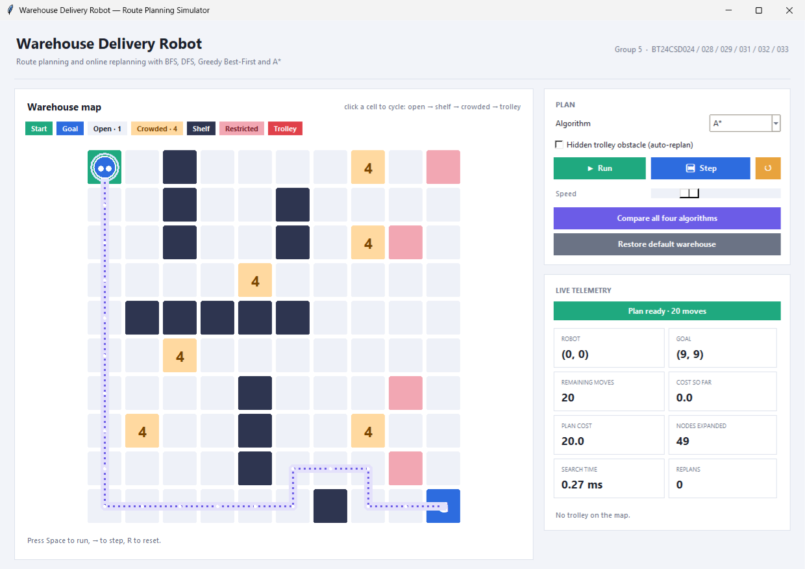

# Task 5 — Performance Evaluation, Visualisation and Documentation

**Assigned To:** Sayan Majhi (BT24CSD028)
**Source Files:** [`metrics.py`](../metrics.py), [`visualization.py`](../visualization.py),
[`gui.py`](../gui.py), [`tests.py`](../tests.py)
**Objective:** Compare the four algorithms on goal reached, moves, path cost, nodes expanded
and execution time; record the number of replans for the trolley experiment; produce labelled
figures, a comparison table and an explanation of whether the shortest route was also the
cheapest.

---

## 5.1 What is measured

| Metric | Definition | Source |
|---|---|---|
| Goal reached | a path from `S` to `G` exists | `SearchResult.goal_reached` |
| Moves | number of edges traversed | `len(path) - 1` |
| Path cost | sum of entry costs, start excluded | `grid.path_cost(path)` |
| Nodes expanded | states removed from the frontier | counter in each search |
| Execution time | wall clock, milliseconds | `time.perf_counter()` |
| Replans | how often A\* was re-invoked (Task 4) | `SimulationResult.replan_count` |

### Timing methodology

One search takes well under a millisecond, so a single `perf_counter()` delta is dominated by
OS scheduling noise — repeated runs of the same algorithm vary by 3–4×. `metrics.benchmark()`
therefore runs every algorithm **25 times** and keeps the fastest run:

```python
def benchmark(grid, repeats=REPEATS):
    results = []
    for fn in ALGORITHMS.values():
        best = fn(grid)
        for _ in range(repeats - 1):
            candidate = fn(grid)
            if candidate.elapsed_sec < best.elapsed_sec:
                best = candidate
        results.append(best)
    return results
```

Moves, costs and node counts are deterministic — verified by
`test_benchmark_keeps_deterministic_metrics` — so only the timing benefits from repetition.
Timings are reported to 0.01 ms: that precision is reproducible across runs on the same
machine, while 0.001 ms jitters by a few units between runs.
Every figure and the results file quote this measured run, which is why the documentation and
the program agree.

---

## 5.2 Comparison table

```text
═══════════════════════════════════════════════════════════════
  Algorithm Performance Comparison — default grid
═══════════════════════════════════════════════════════════════
Algorithm | Goal?  | Moves  | Cost      | Nodes  | Time(ms)
───────────────────────────────────────────────────────────────
BFS       | Yes    | 18     | 21.0      | 82     | 0.11
DFS       | Yes    | 24     | 30.0      | 43     | 0.06
Greedy    | Yes    | 20     | 20.0      | 21     | 0.04
A*        | Yes    | 20     | 20.0      | 49     | 0.15
───────────────────────────────────────────────────────────────

  Key findings:
    • Fewest moves   : BFS (18 moves)
    • Lowest cost    : Greedy, A* (cost 20.0)
    • Fewest nodes   : Greedy (21 nodes expanded)
    • → Shortest-move path ≠ lowest-cost path: crowded cells inflate cost along
      the fewest-move route.
```

| Algorithm | Goal | Moves | Path cost | Nodes | Time (ms) |
|---|:---:|---:|---:|---:|---:|
| **BFS** | yes | **18** | 21.0 | 82 | 0.11 |
| **DFS** | yes | 24 | 30.0 | 43 | 0.06 |
| **Greedy** | yes | 20 | 20.0 | **21** | **0.04** |
| **A\*** | yes | 20 | **20.0** | 49 | 0.15 |

---

## 5.3 Trolley experiment

| Metric | Value |
|---|---|
| Trolley cell | (3,0) — hidden from the robot |
| Initial plan | 20 moves, cost 20.0 |
| Replans | 1 |
| Replan result | 16 moves, cost 19.0, 34 nodes |
| Executed route | 18 moves |
| Goal reached | yes |

Blocked-corridor case (no alternative): initial plan 19 moves / 19.0, detection at (0,3) from
(0,2), **no path found**, goal not reached, robot halts.

---

## 5.4 Findings

### Finding 1 — the shortest route is not the cheapest

> **Does the shortest route also have the lowest cost? No.**
>
> BFS walks 18 moves but pays 21.0 because its route crosses the crowded cell at (5,2);
> A\* walks 20 moves and pays 20.0 by staying in open aisles.

The corridor experiment makes the trade-off explicit: BFS 10 moves at cost 22.0 versus A\*
12 moves at cost 12.0. The extra two moves buy a saving of 10.0 because each avoided crowded
cell is worth 3 extra cost units and a detour step costs 1.

### Finding 2 — efficiency trade-offs

| Criterion | Winner | Why |
|---|---|---|
| Cost optimality | A\* | admissible $h$ guarantees the lowest-cost path |
| Move optimality | BFS | FIFO order guarantees the minimum depth |
| Least expansion | Greedy (21 nodes) | follows $h$ directly, explores little else |
| Lowest cost route found here | A\*, Greedy (20.0) | Greedy's success is incidental, not guaranteed |
| Worst route | DFS (24 moves, 30.0) | depth-first dive ignores cost entirely |

BFS expands 82 nodes to A\*'s 49: level-order search must exhaust every state reachable in
fewer than 18 moves. Greedy expands 21 nodes, but nothing in its rule prevents it from walking
into expensive cells when they lie toward the goal.

### Finding 3 — replanning is cheap and effective

The one-step lookahead detected the trolley one cell early, and the replan from (2,0) took
34 node expansions — cheaper than the original 49-node search, because the remaining problem
is smaller. The executed route costs 19.0 against the blocked plan's 18.0 tail: the robot pays
one extra cost unit instead of failing the delivery. When the corridor is genuinely severed the
same code path reports "no alternative" instead of looping.

---

## 5.5 Figures

| Figure | File | Content |
|---|---|---|
| Floor plan | `screenshots/grid_overview.png` | Rounded tiles, rulers, legend, cell inventory |
| Algorithm routes | `screenshots/algorithm_routes.png` | 2×2 comparison, per-algorithm metrics in the caption |
| Cost ≠ moves | `screenshots/cost_vs_moves.png` | BFS vs A\* on the two-row corridor |
| Trolley replanning | `screenshots/trolley_replanning.png` | Initial plan → detection → replan → executed route |
| No alternative | `screenshots/no_alternative_path.png` | Blocked corridor and the failed replan |
| Performance | `screenshots/performance_chart.png` | Nodes, cost vs moves, execution time |
| Simulator | `screenshots/gui.png` | The Tkinter application |

Design: a single palette shared by all figures and the GUI (open `#F1F4FA`, crowded `#FFD9A0`,
shelf `#2E3550`, restricted `#F2A7B3`, start `#1FA97F`, goal `#2D6CDF`, trolley `#E0414A`),
DejaVu Sans throughout, no chart junk — gridlines only where they carry value, spines removed,
every panel captioned with its own numbers.

---

## 5.6 Interactive simulator

| Feature | Behaviour |
|---|---|
| Algorithm selector | BFS / DFS / Greedy / A\* — the plan and telemetry update immediately |
| Run / Pause | animated traversal (40–500 ms per step) |
| Step | advance exactly one cell |
| Click a cell | cycle open → shelf → crowded → trolley |
| Hidden trolley mode | auto-places a trolley on the plan; detection and replanning happen live |
| Telemetry cards | robot cell, goal, remaining moves, cost so far, plan cost, nodes, search time, replans |
| Comparison table | all four algorithms on the current map |
| Keyboard | `Space` run/pause, `→` step, `R` reset |
| Reset | rebuilds the map from the pristine layout, so obstacles detected in an earlier run do not persist |



---

## 5.7 Test suite

`python -m unittest tests.py -v` → **51 tests, all passing**.

| Class | Tests | Coverage |
|---|---:|---|
| `TestWarehouseGrid` | 14 | construction, bounds, costs, actions, goal test, cloning, dynamic marking |
| `TestLayoutValidation` | 3 | ragged, empty and goal-less layouts rejected |
| `TestDefaultEnvironment` | 3 | every cell type present, map solvable, restricted zones impassable |
| `TestManhattan` | 3 | zero, known distance, symmetry |
| `TestBFS` | 4 | reachability, blocked map, connectivity, optimal moves |
| `TestDFS` | 3 | reachability, blocked map, connectivity |
| `TestGreedy` | 2 | reachability, blocked map |
| `TestAStar` | 6 | reachability, blocked map, optimality vs BFS and Greedy, detour, start override |
| `TestCostVsMoves` | 2 | the corridor numbers quoted above |
| `TestTrolleySimulator` | 5 | run, replan count, no-trolley baseline, custom position, trace start |
| `TestNoAlternativeRoute` | 2 | failed replan and "never enters the blocked cell" |
| `TestBenchmark` | 2 | all algorithms measured, deterministic metrics preserved |
| `TestRunAll` | 2 | registry contents, all algorithms find a path |

---

## 5.8 Generated results

`python main.py` writes [`results/performance_results.md`](../results/performance_results.md)
with the numbers measured on that run, so the report can never drift from the code. The README
quotes the same run.

---

## 5.9 Deliverables

| Deliverable | Location | Status |
|---|---|:---:|
| Complete source | `*.py` | ✅ |
| Problem statement, algorithms, dependencies, run instructions | `README.md` | ✅ |
| Grid, route, trolley and performance screenshots | `screenshots/` (7 files) | ✅ |
| Trolley + replanning demonstration, including the failure case | `screenshots/trolley_replanning.png`, `no_alternative_path.png` | ✅ |
| Performance comparison table and findings | README §8, this report §5.2–5.4 | ✅ |
| Names, roll numbers, contributions, task matrix | README §2 | ✅ |
| Per-task documentation | `task_reports/Task1…Task5` | ✅ |
| Test suite | `tests.py` (51 tests) | ✅ |
